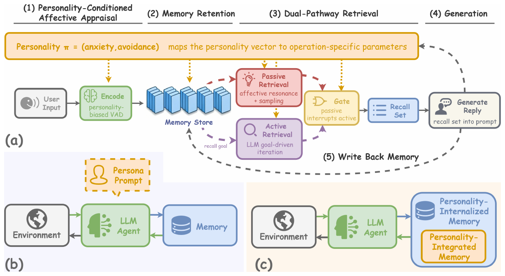
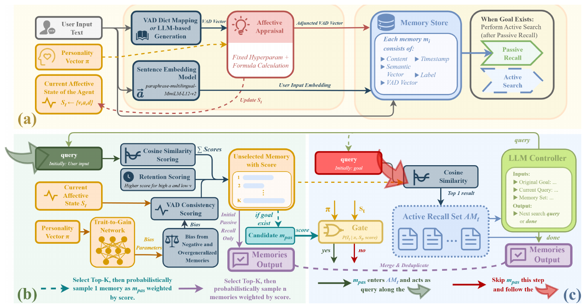
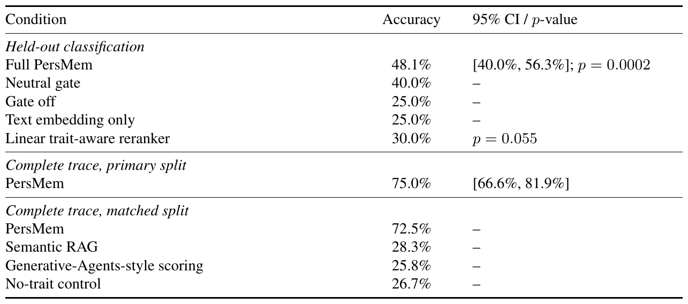
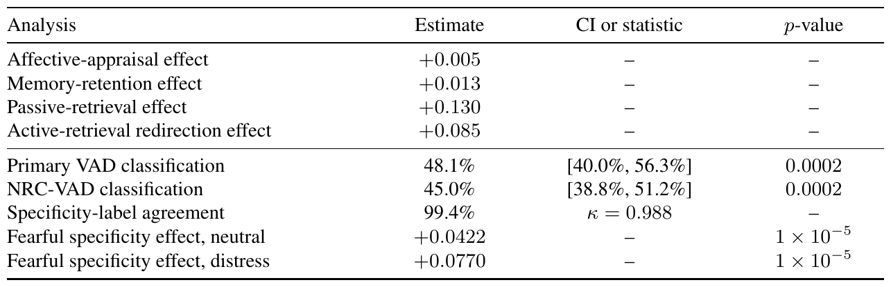
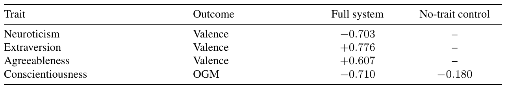
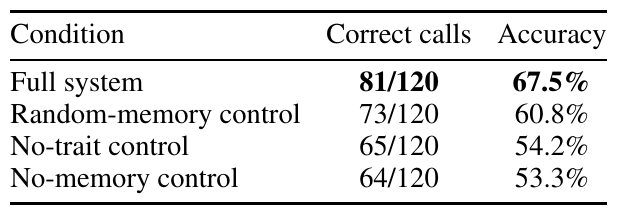
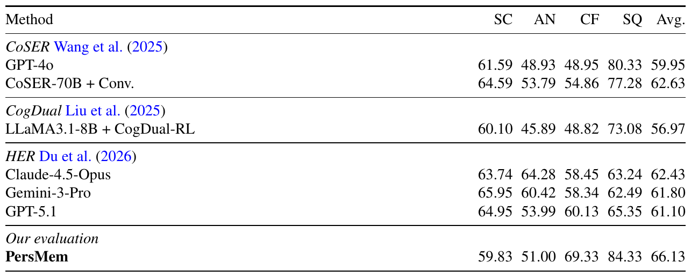
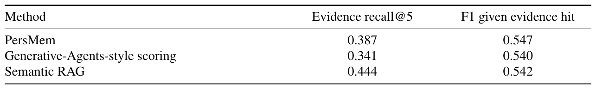

> \[[Paper](https://arxiv.org/abs/2609.34372)\]
>
> Hanzhong Zhang, Ziwei Xiang, Weicheng Xie, Shizhe Liu, Siyang Song

## Introduction

LLM 기반 role-playing agent는 보통 system prompt에 personality를 적고, 별도의 memory module에서 과거 대화를 검색한다. 이때 personality는 응답을 표현하는 방식에는 영향을 주지만, 어떤 경험을 정서적으로 해석하고 오래 보존하며 다시 떠올리는지에는 직접 반영되지 않을 수 있다. 예를 들어 부정적인 경험을 쉽게 떠올리도록 설정한 agent가 semantic similarity만으로 긍정적인 기억을 검색하면, response model에 전달되는 근거와 personality 설정이 서로 다른 방향을 가리킨다.

PersMem(Personality-Integrated Memory)은 personality를 응답 생성 이전의 memory processing에 통합한다. 고정된 trait vector가 affective appraisal, memory retention, passive affect-driven retrieval, active goal-driven retrieval의 redirection을 조절한다. Active retrieval controller와 response model에는 trait vector나 명시적인 persona instruction을 제공하지 않으며, personality가 바꾼 affective state와 검색 결과를 통해 응답에 영향을 준다.

_Fig 1. Personality를 system prompt에만 두는 구조와 PersMem의 비교. PersMem에서는 하나의 personality representation이 appraisal, retention, passive retrieval 및 active retrieval의 gate를 조절하고, 선택된 기억이 response generation으로 전달된다._

논문이 다루는 핵심은 personality를 문장으로 지시했는가보다, 그 personality에 따라 memory processing이 달라지는가이다. 이를 확인하기 위해 attachment personality와 Big Five라는 두 trait space에 같은 memory-stage interface를 적용하고, memory trace와 최종 대화를 각각 평가한다.

1. Fixed low-dimensional trait vector를 네 memory operation의 parameter로 연결하는 autobiographical memory architecture를 제안한다.
2. Passive retrieval이 제안한 기억이 active retrieval의 다음 query를 바꿀 수 있는 personality-conditioned redirection을 도입한다.
3. Attachment classification, Big Five 대화 비교, CoSER role-playing 및 supplementary memory task로 결과를 평가한다.

## Related Work

### Memory Systems for LLM Agents

Generative Agents는 semantic relevance, recency, importance를 결합하며, MemoryBank는 forgetting과 reinforcement를 도입한다. 다른 memory system은 paging, consolidation, hierarchical storage, layered character memory로 긴 context를 관리한다. 이러한 접근은 기억의 저장과 접근을 개선하지만, 하나의 고정된 personality representation을 여러 memory operation에 일관되게 연결하는 것이 주목적은 아니다.

### Personality-Aware Role-Playing Agents

기존 role-playing agent는 written persona, character data, Big Five prompting 또는 internal activation steering으로 성격을 표현한다. LD-Agent, CHARMAP, Emotional RAG처럼 persona나 affect를 memory retrieval에 연결하는 방법도 있다. PersMem은 personality를 retrieval의 한 요소로만 사용하는 대신 appraisal, retention, passive recall, active-search redirection 전체에 연결하고, response generation 이전의 memory trace를 관찰한다.

### Psychological Foundations

Mood-congruent memory는 현재 affect와 personality에 따라 emotional information의 accessibility가 달라지는 현상을 설명한다. Self-memory system은 autobiographical recall이 self와 현재 goal의 영향을 함께 받는다고 본다. Overgeneral autobiographical memory에 대한 functional-avoidance 관점은 구체적인 사건 대신 일반화된 기억을 떠올리는 mechanism의 배경이 된다.

논문은 attachment anxiety와 avoidance의 2차원 공간 및 Big Five의 5차원 공간을 사용한다. 이 심리학적 배경은 memory operation의 설계 근거이며, 구현된 수식의 계수가 인간의 실측 효과를 그대로 나타낸다는 의미는 아니다.

## Method

### Preliminaries

Attachment setting의 personality는 $$\pi=(\pi_{\mathrm{anx}},\pi_{\mathrm{avo}})\in[0,1]^2$$, Big Five setting은 $$\pi_{\mathrm{BF}}=(O,C,E,A,N)\in[0,1]^5$$로 표현한다. Trait vector는 대화 중 고정되며, affective state는 매 turn 갱신한다.

각 memory는 text, normalized sentence embedding, VAD annotation, timestamp 및 specificity label을 가진다.

$$
\begin{equation}
m=(x_m,z_m,e_m,t_m,\mathrm{spec}_m),
\qquad e_m=(v_m,a_m,d_m).
\notag
\end{equation}
$$

VAD는 valence, arousal, dominance를 의미하며, $$v\in[-1,1]$$, $$a,d\in[0,1]$$이다. Specificity는 특정 사건을 나타내는 specific memory와 일반화된 overgeneral memory를 구분한다. Sentence embedding에는 `paraphrase-multilingual-MiniLM-L12-v2`를 사용한다.

_Fig 2. 입력의 personality-conditioned VAD를 계산하고 current affective state를 갱신한다. Passive pathway는 초기 기억을 선택하고 active search 중에도 candidate를 제안한다. Active pathway는 gate에 따라 이 candidate를 채택하거나 semantic retrieval과 query refinement를 계속한다._

### Affective Appraisal

LLM annotator 또는 affective lexicon이 입력을 raw VAD vector $$\tilde e=(\tilde v,\tilde a,\tilde d)$$로 변환한다. Personality-dependent mapping이 이를 $$e=A_\pi(\tilde e)$$로 조정한다. Attachment setting의 조정은 다음과 같다.

$$
\begin{equation}
\begin{aligned}
v'&=\operatorname{clip}_{[-1,1]}\!\left(
\tilde v+\kappa_v(1-\pi_{\mathrm{anx}})[\tilde v]_+
-\kappa_v\pi_{\mathrm{anx}}[-\tilde v]_+
\right),\\
a'&=\operatorname{clip}_{[0,1]}\!\left(
\tilde a+\kappa_a\pi_{\mathrm{anx}}[-\tilde v]_+
-\kappa_{\mathrm{damp}}\pi_{\mathrm{avo}}\tilde a
\right),\\
d'&=\operatorname{clip}_{[0,1]}\!\left(
\tilde d+\kappa_p\pi_{\mathrm{avo}}(1-\tilde d)
-\kappa_q\pi_{\mathrm{anx}}\tilde d
\right).
\end{aligned}
\tag{2}
\end{equation}
$$

여기서 $$[x]_+=\max(x,0)$$이다. Anxiety는 negative valence와 negative-event arousal을 강화하고 dominance를 낮춘다. Avoidance는 arousal을 낮추고 dominance를 높인다.

Current affective state는 현재 입력과 이전 reply state를 결합하여 갱신한다. Reply 생성 이후에도 같은 appraisal을 적용하고, 완료된 exchange의 VAD는 입력과 reply의 adjusted VAD 평균으로 저장한다.

$$
\begin{equation}
\begin{aligned}
s_t^{\mathrm{in}}&=(1-\lambda)s_{t-1}^{\mathrm{out}}+\lambda e_t^{\mathrm{in}},\\
s_t^{\mathrm{out}}&=(1-\lambda)s_t^{\mathrm{in}}+\lambda e_t^{\mathrm{out}},\\
e_{m,t}&=\frac{e_t^{\mathrm{in}}+e_t^{\mathrm{out}}}{2}.
\end{aligned}
\tag{3}
\end{equation}
$$

Retrieval에는 입력을 반영한 state를 사용한다. Trait vector 자체가 변하는 것과 현재 affective state가 변하는 것은 구분된다.

### Memory Retention

Memory accessibility는 시간에 따라 exponential decay한다. Decay rate에는 memory arousal과 personality-conditioned negative-memory factor가 함께 들어간다.

$$
\begin{equation}
\begin{aligned}
r(m;\pi)&=r_0(1-ca_m)
\max\!\left(\epsilon_{\mathrm{ret}},1-\rho\pi_{\mathrm{anx}}[-v_m]_+\right),\\
\operatorname{ret}(m,t;\pi)&=\exp\!\left(-(t-t_m)r(m;\pi)\right).
\end{aligned}
\tag{4}
\end{equation}
$$

High-arousal memory는 천천히 잊히고, attachment anxiety는 negative memory의 decay를 추가로 늦춘다. Retention은 memory를 즉시 삭제하는 규칙이 아니라 이후 passive-retrieval score의 한 항으로 사용된다.

### Passive Affect-Driven Memory Retrieval

Passive retrieval은 semantic similarity, affective relation, retention을 결합한다.

$$
\begin{equation}
\begin{aligned}
S_{\mathrm{pas}}(m)&=\alpha\operatorname{sem}(q,m)
+\beta_\pi R(s,m;\pi)+\gamma\operatorname{ret}(m,t;\pi),\\
\operatorname{sem}(q,m)&=z_q^\top z_m,
\qquad \beta_\pi=\beta(1+\xi\pi_{\mathrm{anx}}).
\end{aligned}
\tag{5}
\end{equation}
$$

Attachment setting의 affective relation은 current state와 memory의 VAD consistency에 personality-dependent preference를 더한다.

$$
\begin{equation}
\begin{aligned}
R(s,m;\pi)={}&w_a(1-|a_s-a_m|)
+w_v\frac{1+v_sv_m}{2}
+w_d(1-|d_s-d_m|)\\
&+\mu\pi_{\mathrm{anx}}[-v_m]_+
+\mu_d\pi_{\mathrm{avo}}d_m
+I_{\mathrm{ogm}}\Delta_{\mathrm{fa}}(s,\pi),\\
\Delta_{\mathrm{fa}}(s,\pi)={}&\kappa_{\mathrm{fa}}
\left(\pi_{\mathrm{avo}}+\frac12\pi_{\mathrm{anx}}\right)
\left(b_{\mathrm{fa}}+[-v_s]_+a_s\right).
\end{aligned}
\tag{6}
\end{equation}
$$

Anxiety는 negative memory, avoidance는 high-dominance memory의 점수를 높인다. 마지막 functional-avoidance term은 specificity label이 overgeneral인 memory에만 적용된다. Distress와 avoidance가 클수록 overgeneral memory를 더 쉽게 선택하도록 설계되어 있다.

Candidate set에서 점수를 softmax distribution으로 바꾸고 memory를 sampling한다.

$$
\begin{equation}
P_{\mathrm{pas}}(m\mid\mathcal C)=
\frac{\exp(S_{\mathrm{pas}}(m)/\tau)}
{\sum_{m'\in\mathcal C}\exp(S_{\mathrm{pas}}(m')/\tau)}.
\tag{7}
\end{equation}
$$

Conversational retrieval에서는 상위 $$K=\max(2n,4)$$개가 candidate이며, 기본 설정은 $n=3$이다. 이 안에서 replacement 없이 sampling한다. Attachment setting의 temperature는 1.0으로 고정한다.

### Active Goal-Driven Memory Retrieval

Explicit recall goal이 있으면 passive retrieval이 만든 초기 set과 별도로 active memory set을 만든다. 각 active step에서 passive pathway는 아직 선택되지 않은 memory 하나를 제안한다. Gate는 그 memory를 active search에 채택할지 결정한다.

$$
\begin{equation}
\begin{aligned}
I_t&=\sigma\!\left(
\lambda_I\left[S_{\mathrm{pas}}(m_t^{\mathrm{pas}})-\theta_\pi\right]+\nu a_t
\right),\\
\theta_\pi&=\theta_0-\eta\pi_{\mathrm{anx}},
\qquad B_t\sim\operatorname{Bernoulli}(I_t).
\end{aligned}
\tag{8}
\end{equation}
$$

Anxiety가 높으면 threshold가 낮아져 redirection이 발생하기 쉬워진다. Gate가 켜지면 제안된 memory를 채택하고 그 text의 앞 60 characters를 다음 query로 사용한다. 해당 step에서는 semantic retrieval과 LLM query refinement를 건너뛴다.

Gate가 꺼지면 현재 query와 semantic similarity가 가장 높은 unused memory를 선택한다. LLM controller는 recall goal, current query, accumulated memory excerpt를 보고 다음 query 또는 `DONE`을 반환한다. Controller에는 personality vector와 current affective state를 제공하지 않는다.

종료 시 passive set과 active set을 merge하고 deduplicate한다. Response prompt에는 role label, verbalized affective state, coarse valence label이 붙은 memory excerpt 및 current input을 제공한다. 명시적인 persona instruction은 없지만, personality가 가공한 state와 memory가 response model의 context를 구성한다.

### Trait-to-Gain Calibration and Big Five Instantiation

Attachment trait-to-gain mapping은 hidden unit 8개의 MLP이며, retrieval의 negative-memory, dominance, functional-avoidance gain을 출력한다. Prespecified memory-bias 및 overgeneral-memory target에 맞춰 Gaussian evolution strategy로 calibration한다. 이는 LLM 자체의 personality fine-tuning과는 다른 parameter fitting이다.

Big Five setting은 같은 pipeline에서 appraisal과 retention의 anxiety 항을 neuroticism 중심으로 바꾸고, extraversion·agreeableness의 positive-memory preference 및 conscientiousness의 specificity 효과를 추가한다. Affective relation은 다음과 같다.

$$
\begin{equation}
\begin{aligned}
R_{\mathrm{BF}}(s,m;\pi_{\mathrm{BF}})={}&
w_a(1-|a_s-a_m|)+w_v\frac{1+v_sv_m}{2}
+w_d(1-|d_s-d_m|)\\
&+\mu N[-v_m]_+
+\mu_{\mathrm{pos}}\left(E+\frac12A\right)[v_m]_+
+\mu_d(1-A)d_m\\
&+I_{\mathrm{ogm}}\kappa_{\mathrm{fa}}
\left((1-C)+\frac12N\right)
\left(b_{\mathrm{fa}}+[-v_s]_+a_s\right).
\end{aligned}
\tag{17}
\end{equation}
$$

Neuroticism은 negative appraisal, negative-memory retention, affective retrieval weight 및 gate firing을 강화한다. Extraversion과 agreeableness는 positive appraisal과 recall을 강화하며, 낮은 agreeableness는 dominance preference를 높인다. 낮은 conscientiousness와 높은 neuroticism은 overgeneral-memory term을 강화한다.

Openness는 별도의 memory score 항으로 직접 추가되지 않고 sampling temperature의 calibration target에 반영된다. Big Five MLP는 다섯 trait를 네 retrieval gain과 sampling temperature로 mapping하며, 일곱 personality anchor에서 calibration한다. Target은 저자가 정한 방향과 크기이며, 외부 인간 관측 자료에서 추정한 효과 계수가 아니다.

## Experiments

### Experiment 1: Attachment Personality Effects on Memory Processing

Secure, anxious, avoidant, fearful의 네 profile을 비교한다. Calibration, classifier development, final test에 각각 63, 92, 165개의 서로 겹치지 않는 memory를 사용하고 development와 test cue도 분리한다. Held-out classifier는 recalled-content statistics와 gate-redirection trace만 사용하며, trait vector, internal resonance·retention score 및 gate probability는 받지 않는다.

_Table 1. Held-out classification과 internal score를 포함한 complete-trace diagnostic. Held-out 결과와 complete-trace 결과는 feature 및 split이 다르므로 같은 지표처럼 비교하면 안 된다._

Full PersMem의 held-out accuracy는 48.1%로, four-way chance 25.0%보다 높다. Neutral gate에서는 40.0%, gate off에서는 25.0%다. Text embedding만 사용하는 classifier는 25.0%, linear trait-aware reranker는 30.0%를 기록한다. 48.1%는 설정한 attachment profile을 memory trace에서 식별한 정확도이며, 임상 진단 정확도나 questionnaire 통과율이 아니다.

_Table 2. Personality-dependent component의 average marginal effect 및 annotation check. Passive retrieval과 active-search redirection의 기여가 appraisal과 retention의 개별 기여보다 크다._

Average marginal effect는 passive retrieval +0.130, redirection +0.085, retention +0.013, appraisal +0.005다. 이 값은 component interaction을 측정하지 않는 descriptive summary다. NRC-VAD annotation으로 바꿔도 held-out accuracy는 45.0%로 chance보다 높다.

Avoidant와 fearful profile은 distress에서 overgeneral memory를 더 많이 검색한다. Response-level three-way classification은 16/30, 53.3%이지만, 각 profile의 열 응답이 연속 대화이므로 독립 관측에 대한 성능으로 해석하지 않는다.

### Experiment 2: Big Five Personality Effects on Recall and Dialogue

OpenPsychometrics의 IPIP Big-Five Factor Markers 자료에서 50개 profile을 sampling한다. 각 profile의 다섯 trait 값을 유지하고, 320개 autobiographical event로 구성된 같은 memory corpus에서 동일한 six-round dialogue를 수행한다. 매 round 세 memory를 검색하며, Qwen3.5-9B가 대화를 생성하고 Llama-3.1-8B가 blind evaluator를 맡는다.

_Table 4. 50개 profile에서 관찰한 trait와 recall outcome의 association. 다섯 trait가 함께 변하므로 단일 trait의 독립적인 causal effect를 나타내지는 않는다._

Neuroticism과 recalled valence의 correlation은 -0.703, extraversion은 +0.776, agreeableness는 +0.607이다. Conscientiousness와 distress 상황의 overgeneral-memory rate는 -0.710이다. 이는 구현된 personality-dependent mapping이 profile별 recall pattern을 만든다는 결과다.

최종 대화 평가는 trait별 상위 12개와 하위 12개 profile을 pairing하여 총 60쌍을 만든다. 각 쌍의 제시 순서를 바꿔 두 번 평가하므로 condition당 120 evaluation call이지만, 독립적인 dialogue pair는 60개다.

{: width="520" }
_Table 5. 두 대화 중 해당 trait가 더 높은 profile을 식별하는 blind forced-choice 평가. Full system 67.5%, random-memory 60.8%, no-trait 54.2%, no-memory 53.3%다._

Full system과 random-memory control의 차이는 6.7 percentage points다. 논문은 같은 pair를 두 presentation order로 재평가했다는 점 때문에 이 차이를 descriptive result로 제시한다. 67.5%는 검사에서 personality score를 맞춘 비율이 아니라 high–low dialogue의 상대적인 식별 정확도다.

### Experiment 3: Role-Playing Evaluation on CoSER

CoSER에서는 Storyline Consistency(SC), Anthropomorphism(AN), Character Fidelity(CF), Storyline Quality(SQ)를 평가한다. PersMem의 evaluator는 DeepSeek-v4-flash이며, 결과는 SC 59.83, AN 51.00, CF 69.33, SQ 84.33, 평균 66.13이다.

_Table 6. PersMem의 CoSER 결과와 기존 연구의 published score. Reference 결과는 각 연구의 evaluation setting을 유지하고 PersMem은 별도의 evaluator를 사용하므로, 동일 조건의 직접적인 순위 비교로 해석할 수 없다._

### Supplementary Evaluations

Fitted gain mapping의 calibration error는 0.084, fixed-gain reference는 0.482다. Calibration target 자체가 설계된 값이므로, 이 차이는 target fit을 나타내며 인간 personality model에 대한 독립적인 validation과는 구분된다.

Positive content만 이야기하도록 하는 adversarial framing에서도 neuroticism-related retrieval difference의 89%가 유지되며, prompt-persona baseline은 58%다. 이 결과는 해당 framing 조건에서 retrieval difference를 유지한 정도이며, 모든 persona attack에 대한 robustness를 보장하지는 않는다.

_Table 8. LoCoMo에서 evidence recall@5 및 evidence가 검색된 경우의 answer F1. Semantic RAG의 evidence recall이 가장 높으며, PersMem의 장점은 모든 retrieval baseline을 일괄적으로 넘는 형태가 아니다._

PersMem의 evidence recall@5는 0.387로 Generative-Agents-style scoring의 0.341보다 높지만, Semantic RAG의 0.444보다는 낮다. Required evidence가 검색된 경우의 answer F1은 각각 0.547, 0.540, 0.542로 비슷하다. Generative-Agents-style scoring 대비 전체 mean answer F1 차이는 +0.0169이며, 95% confidence interval은 0.0027–0.0310이다. 논문은 개선이 주로 relevant evidence를 더 자주 찾는 데서 온다고 설명한다.

## Conclusion

PersMem은 fixed personality vector를 appraisal, retention, passive retrieval, active-search redirection에 연결한다. Personality를 명시적인 generation instruction으로만 표현하지 않고, 어떤 memory를 선택하고 다음 search를 어떻게 이어 가는지에 반영한다는 것이 핵심이다. Attachment와 Big Five 실험은 memory trace 및 최종 대화에서 설정한 profile과 관련된 차이를 보여준다.

### Limitations

Personality-dependent mapping은 저자가 정한 design choice이며 validated computational model of human personality로 해석하면 안 된다. Prespecified calibration target에 잘 맞는 것과 인간의 실제 memory bias를 재현하는 것은 별도의 문제다. 논문은 human judgement를 통한 memory·dialogue behaviour validation, 더 긴 interaction 및 더 넓은 personality·memory setting에서의 평가를 후속 과제로 제시한다.
