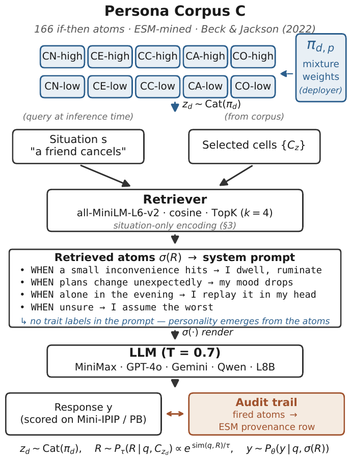
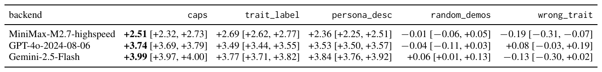
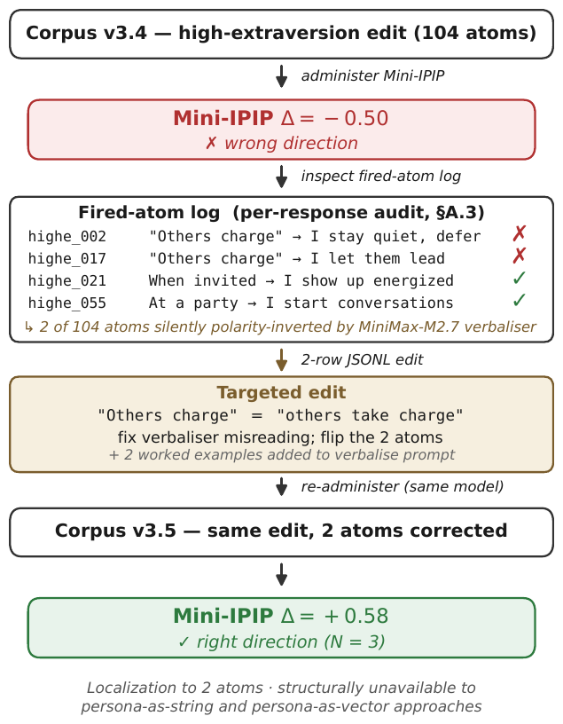
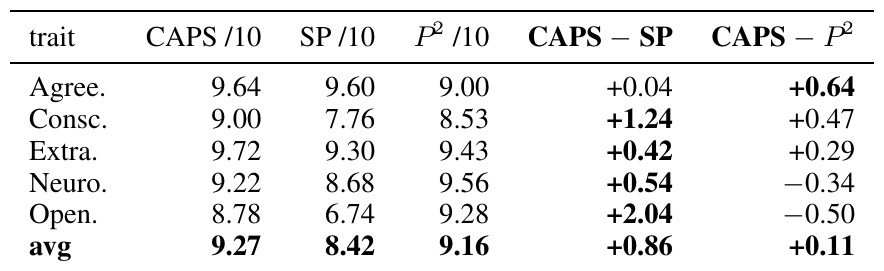
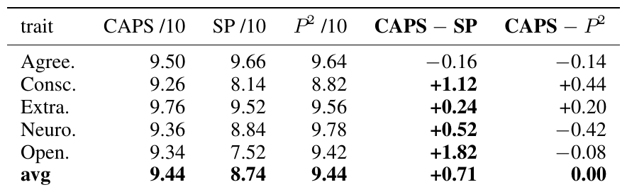
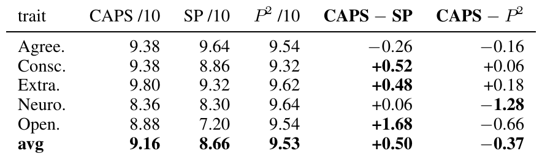
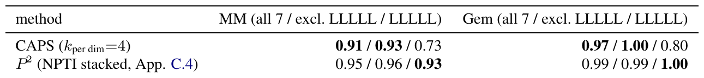
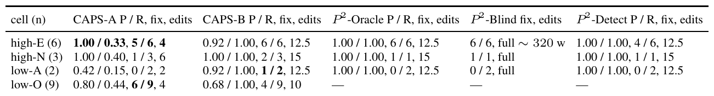

> \[[Paper](https://aclanthology.org/2026.emnlp-main.1495/)\] \[[Github](https://github.com/caps-research/persona-caps)\]
>
> Guanghao Liu, Guangzhou An, Yang Xu, Yu Chen

## Introduction

LLM의 personality control은 trait label이나 character card를 system prompt에 넣는 persona-as-string과, model 내부의 activation을 조절하는 persona-as-vector로 나눌 수 있다. 전자는 closed model에서도 적용하기 쉽고 후자는 internal intervention을 제공하지만, 특정 응답이 persona의 어떤 구성 요소를 근거로 생성됐는지 추적하거나 문제가 있는 부분만 지속적으로 수정하는 interface는 별개의 문제다.

Persona-CAPS는 personality를 situation–behavior contingency의 corpus로 표현한다. 현재 상황과 관련된 if-then atom을 검색하고, 검색된 atom을 trait label 없는 system prompt로 바꿔 응답을 생성한다. 각 응답과 함께 fired atom 및 원본 관측 자료의 provenance를 기록한다.

이 접근은 Cognitive-Affective Personality System(CAPS)에 기반한다. Personality의 일관성을 모든 상황에서 똑같이 행동하는 것으로 보지 않고, 어떤 상황에서 어떤 반응을 보이는지의 안정적인 if-then pattern으로 표현한다. Persona-CAPS는 이 contingency를 자연어로 읽고 수정할 수 있는 retrieval unit으로 구현한다.

논문의 기여는 control strength뿐 아니라 inspectability와 editability에 있다.

1. Personality를 situation-dependent if-then atom의 집합으로 표현하고, 응답마다 retrieval trace를 제공한다.
2. Public Experience Sampling Method(ESM) 자료에서 166개 atom을 구축하고 source observation으로 연결한다.
3. Mixture weight로 personality strength를 조절하고 Big Five의 여러 dimension을 조합한다.
4. 의도적으로 polarity error를 삽입한 뒤 localization, intervention, verification을 수행하는 audit loop를 평가한다.

## Related Work

### Persona-as-String

Trait prompting, character card, paragraph-based persona는 natural-language instruction으로 성격을 전달한다. PersonaAgent는 prompt를 test time에 최적화하고, DPRF는 human ground truth에 맞춰 description을 수정하며, PsyAgent는 Big Five prior와 contexting 및 fine-tuning을 결합한다. BIG5-CHAT은 grounded dialogue corpus를 사용한다.

이 방법들은 성격을 잘 표현할 수 있지만, runtime representation이 하나의 description이면 situation별 retrieval unit과 persistent row-level edit가 기본 interface에 포함되지 않는다. Persona-CAPS는 control을 유지하면서 persona의 최소 수정 단위를 atom으로 둔다.

### Persona-as-Vector

Persona vector, NPTI, DPR, IRiS는 internal activation이나 neuron pattern을 찾아 personality를 조절한다. IRiS는 CAPS에 기반한 situational routing이라는 점에서 관련되지만, model 내부의 intervention을 다룬다. Persona-CAPS의 atom은 neuron pattern이 아니라 자연어 contingency이며, weight access 없이 closed model에도 적용할 수 있다.

### Retrieval-Augmented Personalisation and LLM Big Five

PersonaRAG는 user data를 검색하여 relevance를 높이고, PersonaAI는 특정 개인의 기록을 이용한다. Persona-CAPS는 검색 단위를 user fact에서 if-then contingency로, 목표를 특정 개인의 모방에서 trait-level disposition의 표현으로 바꾼다. Big Five questionnaire는 고정된 조건에서 trait expression을 확인하는 diagnostic으로 사용하고, free-response benchmark를 함께 평가한다.

## Method

### Preliminaries

CAPS 관점에서 persona는 상황에 반응하는 cognitive-affective pattern이다. 본 논문은 전체 cognitive-affective unit 체계를 그대로 구현하기보다 situation과 behavior를 중심으로 단순화한다. Big Five의 각 dimension에 high와 low polarity를 두어 열 개의 cell을 만든다.

$$
\begin{equation}
\mathcal C=\{a_1,\ldots,a_n\},
\qquad
\{\mathcal C_z\}_{z=(d,p)}.
\notag
\end{equation}
$$

$d$는 personality dimension, $p$는 polarity다. Deployer는 사용할 cell과 mixture weight를 선택하지만, response model에 전달하는 prompt에는 trait label을 넣지 않는다. Label-free는 LLM interface의 성질이며 corpus 구축과 cell 선택까지 label을 전혀 사용하지 않는다는 의미는 아니다.

### Atoms, Retrieval, and Agent

각 atom은 situation, behavior 및 optional affect, goal, dimension, polarity metadata로 구성된다. Natural-language situation과 behavior는 JSONL의 한 row에 저장한다.

$$
\begin{equation}
a=(\mathrm{situation},\mathrm{behavior},
[\mathrm{affect}],[\mathrm{goal}],[\mathrm{dim}],[\mathrm{pol}]).
\notag
\end{equation}
$$

Retriever는 current query와 atom의 situation field만 `all-MiniLM-L6-v2`로 encoding한다. 384-dimensional embedding을 L2-normalize하고 cosine similarity로 top-$k$ atom을 선택하며 기본 $k$는 4다. Behavior field를 embedding에 함께 넣지 않아, 검사 문항의 행동 표현과 atom의 행동 표현을 직접 matching하는 효과를 줄인다.

{: width="520" }
_Fig 1. Big Five dimension과 polarity별 corpus에서 atom을 검색하고 trait label 없는 system prompt로 rendering한다. Response와 함께 fired atom 및 ESM provenance를 저장한다. Single-dimension mode는 mixture weight로 polarity cell을 선택하고, joint mode는 dimension별 검색 결과를 결합한다._

고정된 renderer가 검색된 atom을 system prompt로 바꾸고 LLM이 응답한다. Fired-atom log는 어떤 contingency가 context에 포함됐는지 보여 주며, 문제가 발견되면 해당 row의 behavior를 수정한 뒤 재평가할 수 있다. Retrieval log가 응답의 완전한 causal explanation이나 root-cause analysis를 보장하는 것은 아니다.

### Baselines

기본 string baseline은 trait label 하나를 사용하는 TraitPromptAgent와 trait 이름 없이 약 150-word character card를 제공하는 PersonaDescriptionAgent다. 같은 retrieval scaffold에서 관련 없는 chitchat atom을 사용하는 `random_demos`, 다른 Big Five dimension의 같은 polarity atom을 사용하는 `wrong_trait`를 ablation으로 둔다.

PersonalityBench에서는 NPTI implementation의 Simple-Prompt(SP)와 P² paragraph prompt를 그대로 사용한다. Continuous-control 실험에는 high·low pole의 비율을 문장으로 직접 지시하는 mixed-percentage prompt도 비교한다.

### Empirically Grounded Corpus from ESM Data

Corpus는 Beck and Jackson의 public ESM dataset `openESM 0060_beck`에서 구축한다. Trait quartile별 participant group을 만들고, 여덟 DIAMONDS situation-perception item 및 열여덟 binary context flag를 behavioral item과 교차한다. High·low group 사이 standardized effect의 차이가 충분한 cell을 선택한다.

$$
\begin{equation}
|d_{\mathrm{high}}-d_{\mathrm{low}}|\geq0.3.
\notag
\end{equation}
$$

선택된 observation을 MiniMax-M2.7이 first-person if-then atom으로 verbalize한다. 최종 corpus는 열 개 cell에 걸친 166개 atom이며, 각 atom은 source observation의 provenance를 가진다. Selection은 human data에 근거하지만 linguistic realization은 LLM이 생성한다.

Mini-IPIP와의 surface overlap 및 nearest-cell check를 수행한다. 모든 Mini-IPIP item에 대한 최대 trigram-Jaccard는 0.134 이하이며, 20개 중 16개 item의 globally nearest atom은 target dimension이 아닌 cell에 있다. 이 검사는 해당 overlap 경로를 점검한 결과이며, 모든 형태의 semantic leakage가 없음을 증명하는 것은 아니다.

### Locus of Probability and Personality Composition

Single dimension의 response distribution은 polarity cell별 prompting context의 operational mixture로 정의한다.

$$
\begin{equation}
\begin{aligned}
P_\theta(y\mid q,\mathcal C,\pi_d)
=\sum_p\pi_{d,p}\,
P_\theta\!\left(
y\mid q,\sigma(\operatorname{TopK}_k(q,\mathcal C_{(d,p)}))
\right).
\end{aligned}
\tag{1}
\end{equation}
$$

$$\pi_{d,p}$$는 학습된 latent distribution이 아니라 deployer가 정하는 control parameter다. 각 query에서 하나의 polarity cell을 sampling하고, 그 cell에서 atom을 검색한 뒤 prompt를 구성한다. 따라서 weight가 0.5라는 것은 한 응답 안에서 두 성향이 정확히 절반씩 섞인다는 의미가 아니다.

$$
\begin{equation}
z_d\sim\operatorname{Categorical}(\pi_d),
\qquad
R=\operatorname{TopK}_k(q,\mathcal C_{z_d}),
\qquad
y\sim P_\theta(y\mid q,\sigma(R)).
\notag
\end{equation}
$$

Softmax retrieval은 cosine similarity를 temperature로 조절하고, deterministic top-$k$는 temperature가 0으로 접근하는 limit로 설명한다. Joint 5-D mode에서는 각 dimension의 endpoint polarity를 선택하고 dimension별 검색 결과를 하나의 prompt에 concatenate한다.

$$
\begin{equation}
R_{\mathrm{joint}}=
\bigcup_{d\in\mathcal D}
\operatorname{TopK}_{k_{\mathrm{per\ dim}}}(q,\mathcal C_{z_d}).
\notag
\end{equation}
$$

## Experiments

### RQ1: Big Five Expression on Mini-IPIP

20-item Mini-IPIP에서 high·low persona의 target-dimension mean 차이인 spread를 측정한다. MiniMax-M2.7-highspeed, GPT-4o-2024-08-06, Gemini-2.5-Flash에 같은 template를 적용하고, temperature 0.7에서 condition별 5회 수행한다. Spread의 theoretical range는 -4부터 +4다.

_Table 2. 세 commercial backbone의 target-dimension spread와 bootstrap 95% confidence interval. CAPS가 모든 backbone에서 trait-label baseline보다 우세한 것은 아니며, MiniMax에서는 두 condition의 interval이 겹친다._

CAPS의 mean spread는 MiniMax +2.51, GPT-4o +3.74, Gemini +3.99다. GPT-4o와 Gemini에서는 두 string baseline보다 크지만, MiniMax의 trait-label +2.69와는 bootstrap interval이 겹쳐 차이를 확정하지 않는다. 이 평가는 고정된 template에서 성향 표현을 확인하는 diagnostic이며, LLM이 인간과 같은 personality를 가진다는 증거로 사용하지 않는다.

### RQ2: Content-Specificity Ablations

`random_demos`와 `wrong_trait`에서는 target spread가 크게 줄어든다. Chitchat atom만으로는 같은 효과가 나타나지 않고, persona와 비슷한 형식이라도 target dimension과 다른 내용이면 충분하지 않다는 결과다.

Cross-distribution check에서는 IPIP-NEO-300 item을 paraphrase한 corpus와 ESM corpus를 matched run으로 비교한다. MiniMax에서 Beck corpus의 spread는 +2.33, IPIP-derived corpus는 +2.23으로, item-bank 기반 corpus가 더 큰 효과를 보이지 않았다.

### RQ3: Compositional Editing

Target과 반대 polarity의 corpus에서 시작하여 target atom을 0, 5, 10, 15, 20개씩 추가한다. 열 개 dimension–polarity condition 모두 target score가 예상 방향으로 움직이고, 평균 absolute shift는 5점 척도에서 1.38이다. 다만 target shift가 가장 큰 off-target shift의 두 배 이상이라는 엄격한 기준은 4/10 condition만 만족한다.

{: width="520" }
_Fig 2. Earlier corpus의 high-extraversion edit에서 잘못 verbalize된 두 atom을 찾아 고친 사례. 같은 model에서 Mini-IPIP 변화 방향이 -0.50에서 +0.58로 바뀌었다. 이는 localize–intervene–verify의 사례이며 모든 edit의 성공을 보장하지 않는다._

이 결과는 atom 추가가 target만 독립적으로 바꾸는 완전한 disentangled control은 아님을 보여 준다. 예를 들어 low-conscientiousness 방향의 edit가 neuroticism까지 크게 움직일 수 있다.

### RQ4: PersonalityBench Head-to-Head

Free-response 평가에는 459개 scenario question으로 구성된 PersonalityBench protocol을 사용한다. MiniMax, Gemini-2.5-Flash, Llama-3-8B Q4를 subject로 두고, CAPS·SP·P²를 같은 GPT-4o judge로 평가한다. Trait–polarity cell당 50개 question을 사용하여 총 4,500개 response를 평가한다.

{: width="680" }
_Table 9. MiniMax의 trait별 PersonalityBench score. CAPS 평균 9.27, SP 8.42, P² 9.16이며 논문의 aggregate delta는 각각 +0.86, +0.11이다._

{: width="680" }
_Table 10. Gemini의 trait별 score. CAPS와 P² 평균은 모두 9.44이며, CAPS는 SP보다 +0.71 높다._

{: width="680" }
_Table 11. Llama-3-8B Q4에서는 CAPS 9.16, SP 8.66, P² 9.53이다. CAPS가 SP를 넘지만 P²보다 -0.37 낮아, 가장 강한 paragraph baseline을 모든 model에서 넘는 결과는 아니다._

CAPS는 SP보다 세 backbone 모두에서 높고 평균 차이는 +0.69/10이다. P²와는 commercial backbone에서 비슷하며 Llama에서는 뒤처진다. Judge를 바꾼 replication, response length를 통제한 분석 및 소규모 human evaluation을 추가하지만, 높은 score 구간의 judge saturation과 response-length 차이는 한계로 남는다.

### RQ5: Continuous Personality Strength Control

High-pole weight를 0, 0.25, 0.5, 0.75, 1로 바꾸고 dimension별 Mini-IPIP mean을 측정한다. 세 commercial backbone의 15개 vendor–dimension cell 모두에서 mean score가 weight에 대해 strictly monotonic하며, endpoint 차이는 최소 2.25 inventory points다.

조절되는 것은 반복 생성에서의 expected trait level이다. 한 query에서는 하나의 polarity cell만 선택하므로, 매 응답의 personality intensity가 중간값으로 고정되는 구조는 아니다. 두 polarity를 한 prompt에 함께 넣는 exploratory mixing은 response distribution을 좁히지만 strict monotonicity를 잃는다.

High·low 비율을 직접 지시하는 mixed-percentage prompt도 15개 중 14개 cell에서 monotonic하며 range와 off-target leakage가 CAPS와 비슷하다. 따라서 strength control만으로 CAPS의 우위를 주장하지 않고, atom-level trace와 editability를 주요 차별점으로 둔다. Vendor에 따라 absolute range가 달라 동일한 weight가 동일한 검사 점수를 의미하지도 않는다.

### RQ6: Joint 5-D Big Five Composition

모든 dimension이 high인 HHHHH, 여기서 한 dimension씩 뒤집은 다섯 profile, 모두 low인 LLLLL을 평가한다. Dimension별 atom을 모아 하나의 prompt로 제공하고 stacked P² paragraph와 비교한다.

Direction-match는 각 trait가 scale midpoint를 요청한 polarity 방향으로 0.25 point 이상 넘는지 확인하는 coarse criterion이다. Target intensity를 정확히 맞췄는지와는 다르다.

_Table 3. 전체 일곱 profile, LLLLL을 제외한 여섯 profile 및 LLLLL만의 direction-match. LLLLL에서는 P²가 두 commercial backbone 모두에서 CAPS보다 20 percentage points 높다._

LLLLL을 제외하면 backbone-level aggregate 차이는 최대 3 percentage points이며, CAPS는 MiniMax 0.93, Gemini 1.00을 기록한다. 모두 low인 profile에서는 각각 0.73, 0.80으로 떨어진다. Model prior에 여러 dimension이 동시에 반하는 조건에서는 explicit paragraph instruction이 더 강하게 작동한다.

### RQ7: Audit-Loop Efficiency

선택한 atom의 situation과 metadata는 유지한 채 behavior를 반대 polarity로 바꿔 corpus를 오염시킨다. Target score의 충분한 변화가 실제로 발생하는지 sanity gate로 확인한 뒤, 잘못된 atom을 찾고 고치고 다시 검사한다.

CAPS-A는 응답의 fired-atom log를 이용해 적은 수의 candidate를 표시하는 incident-driven triage다. CAPS-B는 전체 corpus의 behavior polarity와 저장된 metadata를 대조하는 sweep이다. P²에는 ground-truth 위치를 알려 주는 Oracle, paragraph 전체를 재생성하는 Blind, 문제 문장을 추정하는 Detect를 비교한다.

_Table 4. Sanity gate를 통과한 condition에서의 precision, recall, fix success 및 edit 수. CAPS-A는 sparse edit, CAPS-B는 높은 recall에 적합하며 어느 한쪽이 모든 cell에서 우세하지 않다._

High-extraversion 조건에서 CAPS-A는 평균 네 atom을 수정하여 5/6 fix success를 얻고, P²-Oracle은 평균 12.5개를 수정하여 6/6을 얻는다. Edit footprint는 이 조건에서 약 0.32배다. 논문의 약 1/3이라는 요약을 모든 trait와 workflow에서 항상 성립하는 비율로 읽으면 안 된다.

Low-agreeableness에서는 CAPS-A가 0/2, CAPS-B가 1/2로, atom-level interface만으로 repair가 자동 성공하지 않는다. MiniMax low-openness에서 P²-sanity가 0/9인 현상도 GPT-4o에서는 재현되지 않아, paragraph가 corruption을 가리는 양상은 subject-dependent하다. 핵심은 candidate atom에 대한 intervention 후 결과를 검증할 수 있다는 interface이며, optimal edit나 automated root-cause analysis를 보장하지 않는다.

### Limitations

PersonalityBench score는 judge와 sampling·quantization setting에 따라 달라지고, 일부 trait에서는 높은 score에 포화된다. CAPS의 응답이 baseline보다 짧고 Llama에서 atom을 그대로 되풀이하며 일찍 끝내는 failure가 있어, post-hoc length control만으로 모든 confound를 닫지는 못한다.

All-low personality 조합과 적은 per-dimension atom budget에서는 model prior에 맞서는 control이 약해진다. Joint mode에서 서로 모순되는 atom을 동시에 검색할 수도 있으며, 이 inter-atom conflict는 별도로 정량화하지 않았다. Pairwise contradiction check와 compatibility-aware reranking은 후속 설계 방향이다.

ESM corpus는 미국 단일 대학의 undergraduate sample에 기반하며, linguistic realization은 LLM이 생성한다. 다른 문화·연령·언어에서 situation과 behavior가 그대로 전달된다고 보기 어렵다. Original CAPS의 encoding, expectancy, belief, goal, plan을 situation–behavior 두 요소로 줄인 점과 소규모 human evaluation, 제한된 audit condition도 적용 범위를 제한한다.

## Conclusion

Persona-CAPS는 persona를 situation-conditioned if-then atom으로 표현하여 retrieval, response generation, audit 및 local edit를 같은 representation 위에서 수행한다. Strong paragraph baseline과 비슷한 control을 얻는 조건이 있지만, 모든 backbone이나 personality 조합에서 우세한 방법은 아니다.

핵심 기여는 personality score 자체를 가장 크게 만드는 데보다, 응답에 사용한 persona unit을 기록하고 잘못된 contingency를 국소적으로 바꾼 뒤 다시 검증하는 interface에 있다. Mini-IPIP와 PersonalityBench 결과는 이 representation이 성향 표현을 조절한다는 근거이며, 임상적 성격장애의 진단이나 장기간의 인간 personality 재현을 검증한 결과는 아니다.
