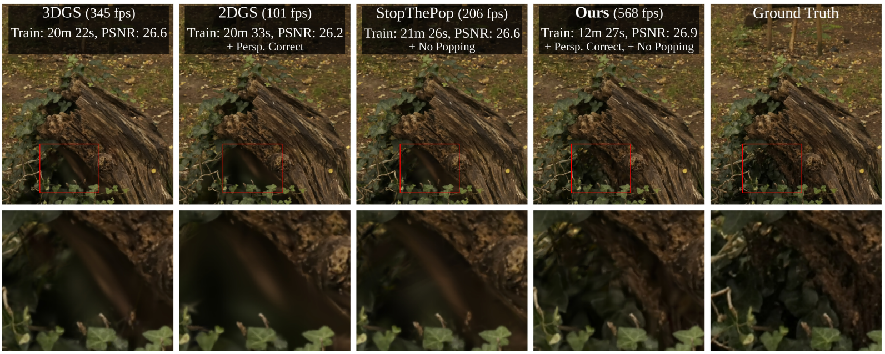
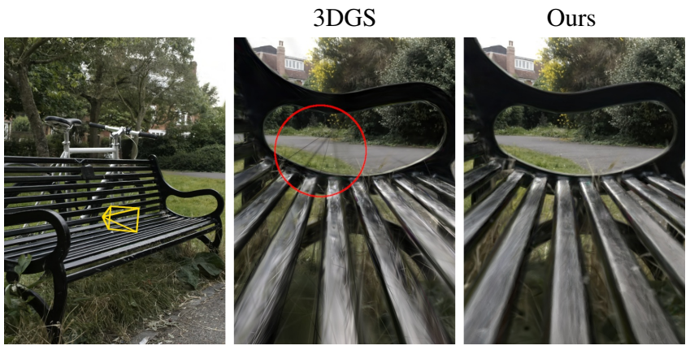
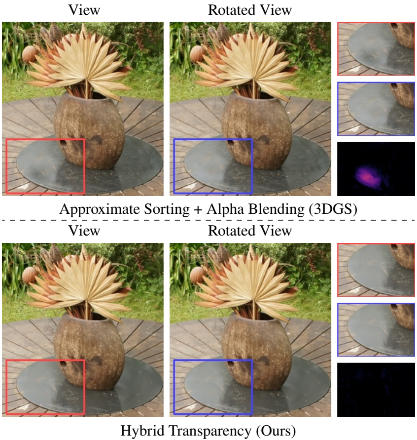
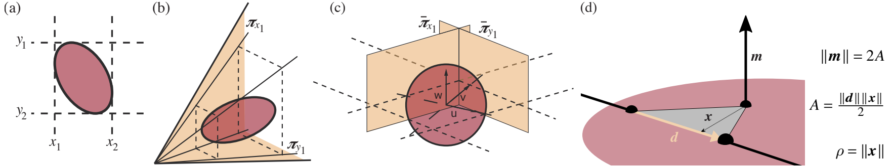
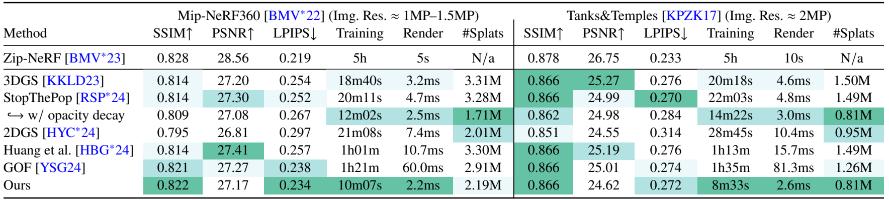
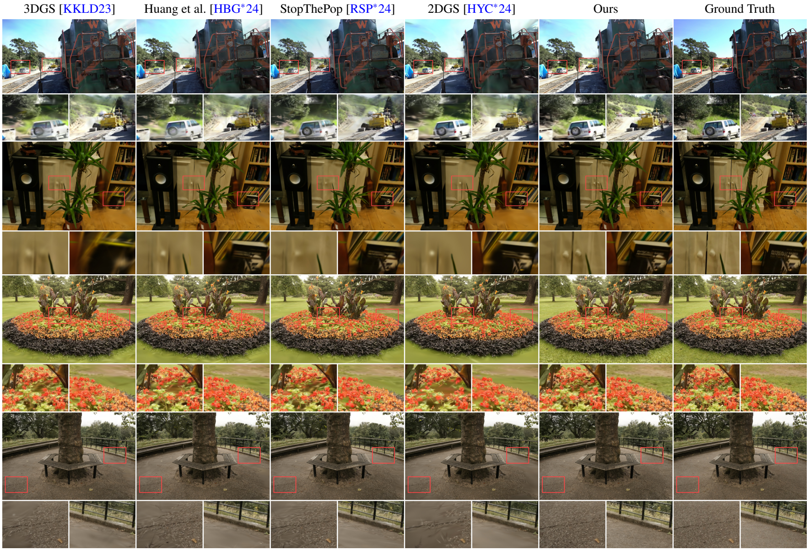
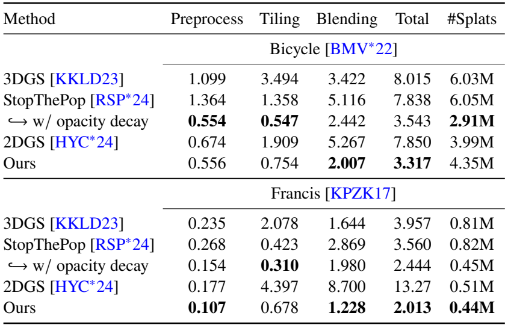
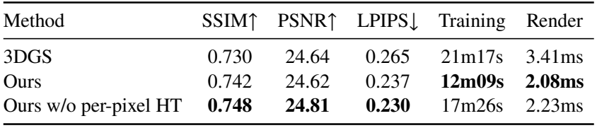
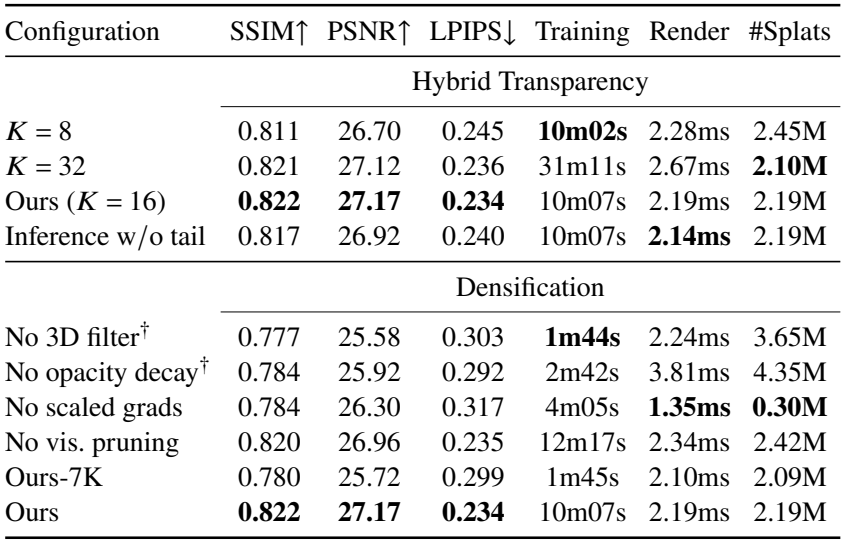
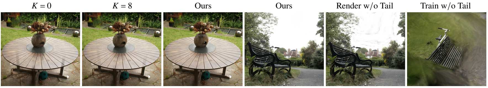

> \[[Paper](https://arxiv.org/abs/2410.08129)\] \[[Page](https://fhahlbohm.github.io/htgs/)\] \[[Github](https://github.com/nerficg-project/HTGS)\]
>
> Florian Hahlbohm, Fabian Friederichs, Tim Weyrich, Linus Franke, Moritz Kappel, Susana Castillo, Marc Stamminger, Martin Eisemann, Marcus Magnor

## Introduction

3D Gaussian Splatting(3DGS)은 anisotropic 3D Gaussian으로 장면을 표현하고 tile-based rasterization으로 렌더링하여 빠른 optimization과 real-time novel-view synthesis를 제공한다. 그러나 Gaussian projection과 depth ordering에 사용하는 approximation은 camera가 움직일 때 multi-view coherence를 깨뜨릴 수 있다.

첫 번째 문제는 affine approximation이다. 3DGS는 3D Gaussian을 image plane에 projection할 때 projective transformation을 local affine transformation으로 근사한다. 일반적인 benchmark에서는 잘 동작하지만, 가까운 거리나 perspective distortion이 큰 시점에서는 splat의 모양과 pixel contribution이 부정확해진다.

두 번째 문제는 Gaussian mean의 view-space depth로 primitive 전체를 정렬하는 방식이다. 실제로는 같은 두 Gaussian이라도 pixel에 따라 앞뒤 관계가 달라질 수 있다. Primitive 단위의 approximate sorting은 camera rotation에 따라 color patch가 갑자기 나타나거나 사라지는 popping artifact를 만든다.

_Fig 1. 3DGS, 2DGS, StopThePop 및 제안 방법의 rendering 비교. 제안 방법은 3D Gaussian의 perspective-correct evaluation과 hybrid transparency를 결합하여 projection artifact와 popping을 줄이고 training 및 rendering을 가속한다._

논문은 이 두 문제를 각각 해결하는 다음 기여를 제시한다.

1. Matrix inversion 없이 pixel별 viewing ray를 따라 3D Gaussian을 평가하는 differentiable formulation. Gaussian의 한 축 이상이 퇴화하는 경우에도 수치적으로 안정적인 evaluation을 지향한다.
2. 앞쪽 $K$개 contribution은 depth order에 따라 alpha blending하고, 나머지는 order-independent하게 합치는 hybrid transparency. 전체 fragment를 완전히 정렬하지 않고 temporal stability와 efficiency를 확보한다.
3. 두 요소를 결합한 PyTorch·CUDA implementation과 기존 3DGS 계열 방법에 대한 비교. 두 개선은 각각 독립적으로 기존 Gaussian splatting system에 적용할 수도 있다.

{: width="520" }
_Fig 2. Bench를 가까이에서 관찰했을 때 나타나는 3DGS의 projection artifact와 perspective-correct evaluation의 비교. 저자들은 일반적인 benchmark의 고정된 test view만으로는 이러한 차이가 충분히 드러나지 않는다고 설명한다._

{: width="520" }
_Fig 3. Camera rotation 전후의 rendering과 확대 영역 비교. 위쪽의 approximate sorting과 alpha blending은 contribution 순서의 변화로 popping을 만들며, 아래쪽의 hybrid transparency는 이를 완화한다._

## Related Work

### Novel View Synthesis

NeRF는 position과 viewing direction을 volumetric density 및 color로 mapping하는 MLP를 학습한다. Differentiable volume rendering으로 높은 품질을 얻지만, 많은 network evaluation 때문에 training과 rendering이 느리다. Voxel grid, multiresolution hash table, tensor factorization은 이러한 비용을 줄이며, Zip-NeRF는 grid-based representation과 anti-aliasing을 결합하여 높은 image quality를 제공한다.

Point-based neural rendering은 explicit point cloud를 사용하지만, hole filling과 feature decoding을 위한 CNN 또는 MLP가 추가 비용을 만든다. 다른 계열은 학습된 NeRF를 mesh나 hybrid representation으로 baking하여 빠른 inference를 제공한다. 다만 NeRF training과 baking 과정이 별도로 필요하다. 이 논문은 별도의 neural image decoder 없이 Gaussian primitive를 직접 rasterize하는 접근을 다룬다.

### Gaussian Splatting

초기 point-based rendering은 opaque splat의 aliasing을 줄이기 위해 semi-transparent splat을 사용했으며, 이 과정에서 sorting과 blending의 비용이 중요한 문제가 되었다. 3DGS는 anisotropic Gaussian, differentiable rasterization, adaptive density control을 결합하여 radiance field의 real-time rendering을 가능하게 했다.

StopThePop은 global presorting 이후 점점 작은 tile과 sliding window에서 hierarchical sorting을 수행하여 popping을 줄인다. 그러나 이 과정의 per-pixel order가 완전히 정확하다고 보장되지는 않는다. 본 논문은 전체 순서를 개선하는 대신, 앞쪽 contribution만 정렬하고 나머지 blending을 바꾸는 방식을 사용한다.

2DGS는 degenerate 3D Gaussian에 해당하는 2D Gaussian surfel의 perspective-correct evaluation을 제공한다. Ray tracing 기반 방법들도 3D Gaussian을 perspective-correct하게 평가할 수 있지만, rendering cost가 크고 matrix inversion에 의한 numerical instability를 고려해야 한다. 본 논문은 기존 ellipsoid 및 surface splatting의 기하학적 계산을 일반적인 3D Gaussian으로 확장하여 rasterization framework 안에서 사용한다.

### Order-Independent Transparency

Alpha blending은 depth order에 의존한다. 정확한 order-independent transparency(OIT)를 얻으려면 fragment를 pixel별로 저장하고 정렬하거나 여러 rendering pass를 수행해야 하므로 비용이 크다.

Approximate OIT는 sorting을 줄이는 대신 blending을 근사한다. Weighted sum이나 weighted blended OIT(WBOIT)는 opacity가 낮고 color가 비슷한 surface에서는 잘 동작하지만, 거의 opaque한 surface에서는 부정확할 수 있다. WBOIT의 depth weighting은 scene별 조정도 필요하다. Moment-based transparency는 transmittance function을 근사하지만, sharp change를 정확히 표현하는 능력과 computational efficiency 사이에 trade-off가 있다.

Hybrid transparency는 transmittance가 뒤로 갈수록 감소한다는 점을 이용한다. 앞쪽 $K$개 surface는 정확히 정렬하여 alpha blending하고, 뒤쪽 surface는 order-independent하게 합친다. 이 논문은 이 원리를 3DGS의 differentiable optimization에 통합하고 tail transmittance의 계산을 수정한다.

## Method

### Preliminaries

Scene은 anisotropic 3D Gaussian 집합으로 표현된다. 각 Gaussian은 mean $\boldsymbol{\mu}\in\mathbb{R}^3$, opacity $o$, principal direction $\mathbf{t}_u,\mathbf{t}_v,\mathbf{t}_w$와 scale $s_u,s_v,s_w$를 가진다. Direction은 normalized quaternion으로, scale은 logarithmic space로 parameterize한다. Opacity는 sigmoid activation을 사용하여 0과 1 사이로 제한한다.

View-dependent color는 3DGS와 동일하게 degree 3까지의 spherical harmonics(SH)로 표현한다. RGB 전체에 사용하는 coefficient는 Gaussian당 48개다. Gaussian을 $3\sigma$에서 자르면 ellipsoid-shaped splat을 얻는다.

Point $\mathbf{x}$에서 Gaussian의 alpha contribution은 다음과 같다.

$$
\begin{equation}
\alpha=o\exp\left(-\frac{1}{2}\rho(\mathbf{x})^2\right),
\qquad
\rho(\mathbf{x})^2=
(\mathbf{x}-\boldsymbol{\mu})^{\mathsf T}
\Sigma^{-1}
(\mathbf{x}-\boldsymbol{\mu}).
\tag{1}
\end{equation}
$$

Depth 순서대로 정렬된 $N$개 contribution의 color는 standard alpha blending으로 계산한다.

$$
\begin{equation}
C=\sum_{i=1}^{N}\alpha_iT_i\mathbf{c}_i,
\qquad
T_i=\prod_{j=1}^{i-1}(1-\alpha_j).
\tag{2}
\end{equation}
$$

$T_i$는 $i$번째 contribution까지 도달하는 transmittance다. 본 방법은 Gaussian을 ray 위에서 평가하는 방식과 contribution을 합성하는 방식을 각각 변경한다.

### Accurate Splat Bounding and Evaluation

#### Tight Screen-Space Bounding

3DGS의 affine projection은 2D Gaussian을 만들고 screen-space bounding box를 구하기 쉽다. 그러나 perspective distortion을 정확하게 반영하지 못한다. 본 방법은 normalized splat space에서 unit sphere에 해당하는 Gaussian을 world space와 screen space로 변환하는 matrix를 사용한다.

Model-view matrix를 $M$, clip-space projection을 $P$, viewport transform을 $V$라 하면 다음과 같다.

$$
\begin{equation}
T'=VPMT,
\qquad
T=
\begin{pmatrix}
\vert&\vert&\vert&\vert\\
s_u\mathbf{t}_u&s_v\mathbf{t}_v&s_w\mathbf{t}_w&\boldsymbol{\mu}\\
\vert&\vert&\vert&\vert\\
0&0&0&1
\end{pmatrix}.
\tag{3}
\end{equation}
$$

_Fig 4. (a–c) Screen-space bounding box, view-space bounding frustum, normalized splat space의 tangent plane 관계. (d) Splat space에서 ray와 원점 사이의 최소 거리를 Plücker coordinate로 계산한다. Ray 위에서 Gaussian 값이 가장 큰 점은 원점과 가장 가까운 점이다._

각 coordinate $$i\in\{1,2,3\}$$의 bounding box 하한과 상한을 $$b_i,t_i$$라 하면 다음 closed-form 계산을 사용한다.

$$
\begin{equation}
b_i=p_i-h_i.
\tag{4}
\end{equation}
$$

$$
\begin{equation}
t_i=p_i+h_i.
\tag{5}
\end{equation}
$$

계산에 사용하는 중간값은 다음과 같다.

$$
\begin{equation}
s=\left\langle
(\rho_c,\rho_c,\rho_c,-1),
T'_4\odot T'_4
\right\rangle,
\qquad
\rho_c=2\ln\frac{o}{\tau_\alpha}.
\tag{6}
\end{equation}
$$

$$
\begin{equation}
\mathbf{f}=\frac{1}{s}(\rho_c,\rho_c,\rho_c,-1).
\tag{7}
\end{equation}
$$

$$
\begin{equation}
p_i=\left\langle\mathbf{f},T'_i\odot T'_4\right\rangle.
\tag{8}
\end{equation}
$$

$$
\begin{equation}
h_i=\sqrt{
p_i^2-\left\langle\mathbf{f},T'_i\odot T'_i\right\rangle
}.
\tag{9}
\end{equation}
$$

$$T'_i$$는 $$T'$$의 $$i$$번째 row, $$\odot$$는 component-wise multiplication이다. $$\tau_\alpha$$는 blending에서 fragment를 고려하는 최소 alpha threshold다. 원문의 $$\rho_c$$는 식 (6)으로 정의되는 cutoff 값이다. Opacity가 낮은 Gaussian은 더 작은 유효 영역을 가지므로 이 cutoff로 bounding box를 줄일 수 있다.

이 계산은 matrix inversion 없이 tight bound를 제공하며, Gaussian이 한 방향 이상으로 퇴화하는 경우에도 적용할 수 있다.

#### Inversion-Free Ray Evaluation

Viewing ray를 inverse matrix로 splat space에 옮기는 대신, ray를 만드는 두 plane을 변환한다. Screen coordinate $$(x_s,y_s)$$를 통과하는 ray는 다음 두 plane의 intersection이다.

$$
\boldsymbol{\pi}_x=(1,0,0,-x_s)^{\mathsf T},
\qquad
\boldsymbol{\pi}_y=(0,1,0,-y_s)^{\mathsf T}.
$$

Homogeneous plane $\mathbf{p}$ 위의 point $\mathbf{x}$는 $\mathbf{p}^{\mathsf T}\mathbf{x}=0$을 만족한다. Plane은 point transformation의 inverse transpose로 변환되므로, screen space에서 splat space로 옮길 때 오히려 forward matrix의 transpose만 필요하다.

$$
\begin{equation}
\boldsymbol{\pi}^{s}_{x/y}
=\left((VPMT)^{-1}\right)^{-\mathsf T}
\boldsymbol{\pi}_{x/y}
=(VPMT)^{\mathsf T}\boldsymbol{\pi}_{x/y}.
\tag{10}
\end{equation}
$$

변환된 plane coefficient를 $$(a^1,a^2,a^3,a^0)$$와 $$(b^1,b^2,b^3,b^0)$$로 두면, 두 plane의 intersection을 dual Plücker coordinate로 나타낼 수 있다.

$$
\begin{equation}
\mathcal{L}^{*}_{s}
=(p^{23}:p^{31}:p^{12}:p^{01}:p^{02}:p^{03}).
\tag{11}
\end{equation}
$$

$$
\begin{equation}
p^{ij}=a^ib^j-a^jb^i.
\tag{12}
\end{equation}
$$

Plücker coordinate의 direction과 moment를 각각 $\mathbf{d},\mathbf{m}$이라 하면, ray와 원점 사이의 거리는 $$\lVert\mathbf{m}\rVert/\lVert\mathbf{d}\rVert$$다. 논문은 dual/primal coordinate의 관계를 정리한 뒤, 공통 scale factor가 소거되는 다음 형태로 Gaussian evaluation에 필요한 squared distance를 직접 계산한다.

$$
\begin{equation}
\rho(\mathbf{x})^2=
\frac{
\left\lVert
\begin{pmatrix}
a^0b^1-a^1b^0\\
a^0b^2-a^2b^0\\
a^0b^3-a^3b^0
\end{pmatrix}
\right\rVert^2
}{
\left\lVert
\begin{pmatrix}
a^2b^3-a^3b^2\\
a^3b^1-a^1b^3\\
a^1b^2-a^2b^1
\end{pmatrix}
\right\rVert^2
}.
\tag{15}
\end{equation}
$$

이 값은 viewing ray 위에서 Gaussian contribution이 최대가 되는 point의 squared distance다. 식 (1)에 대입하면 alpha를 얻는다. Matrix inversion이 필요하지 않으며, 분모가 0이 되는 경우를 감지하여 ray가 splat을 놓치는 경우를 처리할 수 있다.

기존 3DGS에 비해 Gaussian별 setup cost는 줄고 pixel별 evaluation cost는 조금 증가한다. 추가 계산은 식 (15)의 division을 제외하면 addition과 multiplication으로 구성되어 빠르게 미분할 수 있다.

### Temporally-Stable Rendering via Hybrid Transparency

정확한 pixel별 Gaussian evaluation만으로는 blending order 문제가 사라지지 않는다. 모든 fragment를 완전히 정렬하는 방식은 비싸고, 반대로 sorting을 모두 없앤 OIT만 사용하면 foreground가 semi-transparent하게 보인다.

논문은 pixel별 contribution을 core와 tail로 나눈다. Core는 앞쪽 $K$개 contribution을 올바른 depth order로 유지하여 standard alpha blending한다. 나머지 contribution은 tail에 order-independent하게 누적한다. 이에 따라 Gaussian mean depth를 기준으로 하는 global presorting이 필요 없어진다.

Pixel별 depth에는 Gaussian mean의 depth가 아니라 해당 viewing ray 위의 maximum-contribution point를 사용한다. Splat space에서 이 point는 $$\mathbf{d}\times\mathbf{m}/\lVert\mathbf{d}\rVert^2$$이며, homogeneous coordinate를 통해 view space로 옮기면 다음과 같다.

$$
\begin{equation}
\mathbf{x}_{\mathrm{view}}
=MT\frac{\mathbf{d}\times\mathbf{m}}{\lVert\mathbf{d}\rVert^2}.
\tag{16}
\end{equation}
$$

식 (16)의 $MT$는 normalized splat coordinate를 view-space point로 변환하는 homogeneous transformation을 나타낸다. 얻어진 $z$ coordinate로 core를 정렬한다.

최종 pixel color는 core, tail, background의 합성으로 계산한다.

$$
\begin{equation}
C=
\sum_{i=1}^{K}\alpha_iT_i\mathbf{c}_i
+T_{K+1}
\left(
(1-T_{\mathrm{tail}})\mathbf{c}_{\mathrm{tail}}
+T_{\mathrm{tail}}\mathbf{c}_{\mathrm{bg}}
\right).
\tag{17}
\end{equation}
$$

$$
\begin{equation}
\begin{aligned}
T_i&=\prod_{j=1}^{i-1}(1-\alpha_j),\\
\mathbf{c}_{\mathrm{tail}}
&=\frac{\sum_{i=K+1}^{N}\alpha_i\mathbf{c}_i}
{\sum_{i=K+1}^{N}\alpha_i},\\
T_{\mathrm{tail}}
&=\prod_{i=K+1}^{N}(1-\alpha_i).
\end{aligned}
\tag{18}
\end{equation}
$$

Tail color는 alpha-weighted average지만, tail transmittance는 개별 transmittance의 product다. 따라서 color blending의 순서는 근사하면서도 tail 전체의 transmittance는 유지한다. 저자들은 기존 hybrid transparency의 average-based tail transmittance보다 이 계산이 정확하다고 설명한다.

Core를 통과한 transmittance $T_{K+1}$는 tail의 영향 전체를 줄인다. Tail 내부의 순서는 필요하지 않으며, backward 계산에 필요한 pixel별 공통 중간값을 forward pass에서 미리 계산하여 사용할 수 있다.

## Experiments

### Setup

평가는 Mip-NeRF360의 9개 scene과 Tanks and Temples intermediate set의 8개 scene, 총 17개 real scene에서 수행한다. Mip-NeRF360의 outdoor image는 4배, indoor image는 2배 downsample한다. Tanks and Temples는 full-resolution image를 사용한다. 모든 scene에 train/test 7:1 split을 적용한다.

비교 방법은 3DGS, StopThePop의 두 configuration, 2DGS, Huang et al.의 projection 방법, Gaussian Opacity Fields(GOF), Zip-NeRF다. Image quality는 SSIM, PSNR, LPIPS로 평가하고 training time, render time, splat 수를 함께 보고한다.

모든 실험은 single RTX 4090에서 수행한다. Rendering은 scene의 test-set view를 100번 반복하여 측정한다. Appendix A에서는 PyTorch framework의 overhead를 줄이기 위해 activation을 splat parameter에 미리 반영하고 SH coefficient를 같은 buffer에 배치하는 benchmarking 절차도 설명한다.

### Implementation and Optimization

제안 renderer는 3DGS implementation을 참고하여 PyTorch와 CUDA로 구현한다. Optimization pipeline과 hyperparameter는 대체로 3DGS를 따르지만, ray-based evaluation에 맞게 다음을 수정한다.

1. 기존 EWA screen-space low-pass filter를 그대로 사용할 수 없어 Mip-Splatting의 3D filter를 적용한다.
2. 기존 screen-space position gradient 대신, splat mean의 gradient를 camera까지 view-space distance의 절반으로 scale하여 densification에 사용한다.
3. Densification 동안 50 iteration마다 opacity에 0.9995를 곱하는 decay를 사용하여 기존 opacity reset을 대체한다.
4. GOF의 densification 변경을 적용하고 visibility score-based pruning으로 low-opacity splat을 제거한다.
5. Core size는 $K=16$, core에 포함될 수 있는 fragment의 최소 alpha threshold는 $\tau_K=0.05$로 설정한다.
6. Core를 유지하는 insertion sort의 divergence를 줄이기 위해 tile size를 $8\times8$로 설정하고, optimized SSIM implementation으로 loss 계산을 가속한다.

따라서 전체 성능은 evaluation과 blending의 변경뿐 아니라 이들에 맞춰 조정된 filtering, density control 및 implementation을 포함한 결과다.

### Results

#### Quantitative and Qualitative Comparisons

_Table 1. SSIM, PSNR, LPIPS, training time, render time, splat 수 비교. Mip-NeRF360은 약 1–1.5 MP, Tanks and Temples는 약 2 MP image를 사용한다. 초록색 표시는 Zip-NeRF를 제외한 상위 세 결과다._

Mip-NeRF360에서 3DGS는 SSIM 0.814, PSNR 27.20 dB, LPIPS 0.254를 기록하며, 본 방법은 각각 0.822, 27.17 dB, 0.234를 기록한다. Training time은 18분 40초에서 10분 7초로, render time은 3.2 ms에서 2.2 ms로 감소한다. Splat 수는 3.31M에서 2.19M으로 줄어든다.

Tanks and Temples에서 두 방법의 SSIM은 0.866으로 같고, LPIPS는 0.276에서 0.272로 낮아진다. 반면 PSNR은 25.27 dB에서 24.62 dB로 낮아진다. Training time은 20분 18초에서 8분 33초로, render time은 4.6 ms에서 2.6 ms로 감소한다. Splat 수는 1.50M에서 0.81M으로 줄어든다.

논문은 전체 평가에서 3DGS 대비 평균 training speedup 2.1배, rendering speedup 1.6배를 보고한다. Image quality는 대체로 유사한 수준이지만 모든 metric에서 향상되는 것은 아니다. Zip-NeRF는 비교한 3DGS 계열 방법보다 높은 image quality를 얻는 대신 training과 rendering cost가 훨씬 크다.

_Fig 5. 3DGS, Huang et al., StopThePop, 2DGS, 제안 방법, ground truth의 정성 비교. 각 scene의 전체 view와 확대 영역을 함께 보여준다._

2DGS는 perspective-correct rendering을 제공하지만 Table 1에서 본 방법보다 낮은 image quality와 느린 rendering을 보인다. Huang et al.의 projection 방법은 3DGS와 비슷한 품질을 얻지만 training과 rendering이 느려진다. GOF는 ray tracing 기반 volume rendering으로 높은 품질을 얻는 대신 real-time rendering에는 도달하지 못한다.

저자들은 trained model을 관찰할 때 background reconstruction이 개선되는 경향을 보고한다. Background가 image border 부근에 자주 나타나고 해당 영역의 perspective distortion이 크다는 점을 근거로, perspective-correct evaluation이 multi-view signal을 더 잘 활용했을 가능성을 제시한다.

#### Performance Breakdown

{: width="520" }
_Table 2. RTX 4090에서 1920×1080 image를 렌더링하는 단계별 시간(ms). 학습된 3DGS model의 splat 수가 가장 많은 Bicycle과 가장 적은 Francis scene을 비교한다._

Bicycle에서 3DGS의 총 시간은 8.015 ms, 본 방법은 3.317 ms다. Tiling은 3.494 ms에서 0.754 ms로, blending은 3.422 ms에서 2.007 ms로 감소한다. Francis에서는 총 시간이 3.957 ms에서 2.013 ms로 감소한다.

본 방법은 global depth sorting을 수행하지 않으므로 Gaussian/tile instance의 key에 16-bit unsigned integer를 사용한다. 이 변경은 tiling을 가속한다. Blending에서도 전체 fragment 대신 core의 partial depth ordering만 필요하다. 단, Table 2의 method별 model은 splat 수도 서로 다르므로 표의 값은 각 학습 결과를 사용한 전체 rendering performance다.

#### Perspectively Correct Splat Evaluation

{: width="520" }
_Table 3. Mip-NeRF360 outdoor 5개 scene의 평균 결과. Ours w/o per-pixel HT는 perspective-correct evaluation을 유지하면서 3DGS의 approximate depth-order alpha blending을 사용하는 configuration이다._

Hybrid transparency를 제외한 configuration은 3DGS 대비 SSIM을 0.730에서 0.748로, PSNR을 24.64 dB에서 24.81 dB로 개선하고 LPIPS를 0.265에서 0.230으로 낮춘다. Training time은 21분 17초에서 17분 26초로, render time은 3.41 ms에서 2.23 ms로 감소한다.

이 configuration은 여전히 approximate sorting을 사용하므로 popping artifact가 남는다. Full method는 이 표에서 2.08 ms의 더 빠른 rendering과 12분 9초의 training time을 기록한다. 저자들은 tight screen-space bound가 memory access, sorting overhead, blending에서 처리하는 splat 수를 줄이는 것이 evaluation 변경의 속도 향상에 크게 기여한다고 설명한다.

#### Hybrid Transparency Ablations

{: width="540" }
_Table 4. Mip-NeRF360의 9개 scene에서 수행한 hybrid transparency 및 densification ablation. Dagger가 붙은 두 configuration은 over-densification으로 memory가 부족해져 7,000 iteration까지만 학습한다._

Core size $K=8$은 SSIM 0.811, PSNR 26.70 dB, LPIPS 0.245, render time 2.28 ms를 기록한다. 기본 설정 $K=16$은 0.822, 27.17 dB, 0.234, 2.19 ms를 기록한다. $K=32$로 늘려도 image quality는 개선되지 않으며, training time은 31분 11초, render time은 2.67 ms로 증가한다.

$K=8$의 rendering이 오히려 조금 느린 이유는 학습 결과의 splat 수가 2.45M으로 기본 설정의 2.19M보다 많아지기 때문이다. 이 실험에서는 core size만으로 rendering cost가 결정되지 않는다.

_Fig 6. 작은 core에서 나타나는 reflective surface의 문제와 tail의 역할. Inference에서 tail을 제거하면 특히 sky의 품질이 조금 낮아지지만, training에서 tail을 사용하지 않으면 reconstruction이 실패한다._

$K=0$처럼 sorting을 완전히 없애면 foreground가 transparent하게 보인다. 작은 core는 semi-transparency로 표현되는 reflective surface에도 문제를 만든다. 기본 설정에서 inference 때만 tail을 제거하면 SSIM 0.817, PSNR 26.92 dB, LPIPS 0.240으로 품질이 조금 낮아지며, rendering은 2.19 ms에서 2.14 ms로 소폭 빨라진다. 반면 training에서 tail을 제거하는 것은 안정적인 optimization을 유지하지 못한다.

#### Densification Ablations

Splat mean gradient에 camera distance scaling을 적용하지 않으면 splat 수가 0.30M까지 줄고 SSIM 0.784, LPIPS 0.317을 기록한다. 이는 under-reconstruction이 발생한 결과다.

3D filter를 제거하거나 opacity decay 대신 기존 opacity reset을 사용하면 over-reconstruction이 발생하여 전체 training을 완료하기 전에 memory가 부족해진다. 따라서 이 두 ablation은 7,000 iteration 결과이며, 기본 설정의 최종 결과와는 학습 길이가 다르다. Table 4는 비교를 위해 Ours-7K 결과도 함께 제시한다.

Visibility pruning을 제거하면 splat 수는 2.42M, training time은 12분 17초로 증가하고 PSNR은 26.96 dB로 낮아진다. 논문은 low-opacity splat을 pruning하는 것이 over-reconstruction과 overfitting을 줄여 quality와 speed를 함께 개선한다고 설명한다.

### Discussion

논문은 고정된 benchmark view의 image metric만으로는 perspective artifact와 popping의 개선을 충분히 평가하기 어렵다고 강조한다. Perspective distortion은 trained scene을 가까이에서 보거나 camera를 회전할 때 더 뚜렷하게 나타난다. 이 때문에 저자들은 supplemental video를 통해 두 개선의 효과를 함께 보여준다.

또한 rendering formulation을 바꾸면 기존 adaptive density control의 동작도 바뀐다. Ray-based evaluation에서 사용할 gradient를 선택하는 문제와 scene의 photometric variation은 reconstruction의 안정성에 영향을 준다. 논문은 splat의 local attribute와 global densification strategy 사이의 직접적인 연결이 여러 3DGS 계열 방법의 robustness를 제한한다고 논의한다.

### Limitations

기존 alpha blending은 transmittance가 threshold보다 낮아지면 early stopping할 수 있다. 그러나 본 hybrid transparency implementation은 core 밖의 모든 pixel contribution에 대해 color와 alpha를 누적한다. Scene이 커져 depth complexity가 증가하면 이 비용이 문제가 될 수 있다. 저자들은 depth prepass와 WBOIT 형태의 depth weighting 결합을 향후 방향으로 제시한다.

일부 결과의 PSNR은 3DGS보다 낮다. 논문은 screen-space aliasing filter 또는 multi-sampling이 없는 점을 가능한 원인으로 본다. 별도의 surface splatting filter도 시도했으나 이 setting에서는 개선을 얻지 못했다고 설명한다.

Lens distortion을 직접 처리하는 evaluation, core에 한정된 보다 정확한 volume rendering, 더 강력한 appearance model은 future work로 제시된다. 이 논문에서 실제 구현하고 검증한 renderer는 maximum-contribution point의 Gaussian evaluation과 core/tail 기반 blending이다.

## Conclusion

이 논문은 3D Gaussian splatting의 perspective projection과 transparency ordering을 함께 개선한다. Plane transformation과 Plücker coordinate를 사용하여 matrix inversion 없이 ray 위의 Gaussian을 평가하고, tight screen-space bounding을 제공한다. Hybrid transparency는 앞쪽 contribution을 depth order에 따라 합성하고 나머지를 order-independent tail로 처리하여 popping을 줄인다.

두 요소는 독립적으로 적용할 수 있으며, 결합한 implementation은 기존 3DGS 대비 training과 rendering을 가속한다. 실험은 유사한 image quality에서 더 적은 splat과 높은 temporal stability를 얻는 결과를 보이는 동시에, PSNR 저하, densification 조정의 필요성, tail accumulation 비용이라는 한계도 제시한다.
